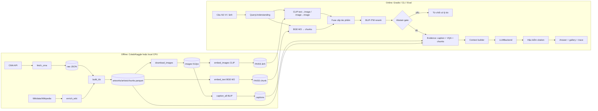

# Thiết kế hệ thống: Trợ lý Bảo tàng Thông minh (Multimodal RAG có dẫn chứng)

> Phiên bản 1.0 (2026-11-25). Tài liệu này mô tả hệ thống được thiết kế như thế nào và vì sao.
> Thứ tự triển khai và các bước kiểm chứng nằm trong [IMPLEMENTATION_PLAN.md](IMPLEMENTATION_PLAN.md).
> Mọi tham số số học (ngưỡng, trọng số, top-N…) trong tài liệu chỉ là **giá trị khởi điểm**. Giá trị thật nằm trong `configs/` và được hiệu chỉnh ở bước đánh giá.

---

## 1. Use case và phạm vi

### 1.1 Bài toán
Người dùng (khách tham quan, học sinh, sinh viên) hỏi bằng **tiếng Việt** về tranh trong bộ sưu tập của Cleveland Museum of Art (CMA), hoặc **tải lên ảnh** một bức tranh. Hệ thống:
1. tìm các tác phẩm liên quan (ảnh + văn bản),
2. trích xuất bằng chứng (metadata, mô tả, caption/VQA từ ảnh),
3. sinh câu trả lời tiếng Việt **chỉ dựa trên bằng chứng**, mỗi khẳng định gắn citation `[IMG-01]`, `[IMG-02]`…,
4. hiển thị ảnh tương ứng với từng citation và đường dẫn nguồn,
5. **từ chối** khi bằng chứng yếu, mâu thuẫn hoặc không có.

Dự án tích hợp Project 1 (CLIP/FAISS + BLIP-ITM) và Project 2 (caption/VQA bằng BLIP) thành các thành phần bên trong của Project 3.

### 1.2 Loại câu hỏi (`QType`)
| QType | Ví dụ | Bằng chứng chính |
|---|---|---|
| `ARTIST` | "Ai vẽ bức *The Biglin Brothers Turning the Stake*?" | overview chunk |
| `DATE` | "Bức này được vẽ năm nào?" | overview |
| `MEDIUM` | "Tranh được vẽ bằng chất liệu gì?" | overview (technique) |
| `LOCATION` | "Tranh đang trưng bày ở phòng nào?" | overview (current_location) |
| `PROVENANCE` | "Trước khi về bảo tàng, tranh thuộc về ai?" | provenance chunk |
| `CULTURE` | "Tranh thuộc nền văn hóa/trường phái nào?" | overview, description |
| `ARTIST_BIO` | "Họa sĩ Eakins là người như thế nào?" | artist_bio chunk (Wikipedia/CMA) |
| `CONTENT` | "Bức tranh nói về điều gì / có ý nghĩa gì?" | description, did_you_know, caption |
| `VISUAL` | "Trong tranh có bao nhiêu người? Màu chủ đạo?" | VQA + caption |
| `RELATED` | "Có tranh nào khác của cùng họa sĩ?" | artworks cùng artist_id |
| `IDENTIFY` | (ảnh tải lên) "Đây là tranh gì?" | CLIP image→image + overview |
| `GENERAL` | fallback | tất cả |

### 1.3 Ngoài phạm vi
Tác phẩm không thuộc kho CMA (hệ thống phải từ chối), định giá tác phẩm, đánh giá thẩm mỹ chủ quan, hội thoại nhiều lượt có suy luận dài (lịch sử hội thoại chỉ được lưu và hiển thị, không đưa vào ngữ cảnh truy xuất).

---

## 2. Dữ liệu

### 2.1 Nguồn (đã kiểm tra thực tế ngày 2026-11-25)
- **CMA Open Access API**: `https://openaccess-api.clevelandart.org/api/artworks/?type=Painting&cc0=1&has_image=1`, gồm 3.964 tranh.
  - Có `description`: **2.210**, đây là tập KB (yêu cầu tối thiểu 1.000).
  - Trong 2.210 tranh đó: `provenance` 2.054, `did_you_know` 1.372, `current_location` 438, tiểu sử họa sĩ trong CMA 296.
  - Phân bố theo bộ phận (≥10 chủ đề): Ấn Độ/ĐNA 745, Trung Quốc 371, Nhật 327, Châu Âu 266, Châu Âu hiện đại 219, Mỹ 121, Trung cổ 95, Hàn Quốc 61, …
  - Dữ liệu và ảnh có giấy phép CC0. Ảnh lấy từ `images.web.url` (khoảng 1.200px).
- **Wikidata + Wikipedia** (bổ sung tiểu sử họa sĩ): `wbsearchentities` → QID → sitelink enwiki → REST `page/summary`. Tra thẳng theo tên chỉ khớp khoảng 40% nên bắt buộc đi qua Wikidata. Văn bản Wikipedia có giấy phép CC BY-SA nên phải ghi nguồn bằng URL bài viết.

### 2.2 Định danh
- `artwork_id = "cma-{cma_id}"` (ví dụ `cma-151904`). `source_url = https://www.clevelandart.org/art/{accession_number}`.
- `artist_id = "cma-artist-{creator_id}"`. Tiểu sử từ Wikipedia mang `source_url` là URL bài Wikipedia.
- `[IMG-xx]` là nhãn **cục bộ trong một câu trả lời** (đánh số 01..K theo thứ hạng evidence). Nó ánh xạ tới `artwork_id` thông qua evidence table của chính câu trả lời đó và không phải ID toàn cục.

### 2.3 Schema (Parquet, trong `data/kb/`)
**`artworks.parquet`**, mỗi tác phẩm một dòng:
| cột | kiểu | ghi chú |
|---|---|---|
| artwork_id | str | khóa chính |
| cma_id, accession_number | int, str | |
| title | str | |
| creation_date | str | chuỗi hiển thị ("c. 1873") |
| date_begin, date_end | int? | dùng cho câu hỏi/gold năm |
| artist_id, artist_name, artist_role, artist_birth, artist_death, artist_nationality | str/int? | lấy creator đầu tiên |
| culture, department, technique, type | str | |
| current_location | str? | null nghĩa là hiện không trưng bày |
| description, did_you_know | str | đã strip HTML |
| provenance_text | str? | các entry nối theo thứ tự "date: description" |
| prev_owner | str? | chủ sở hữu ngay trước CMA (parse; dùng làm gold) |
| exhibitions_text | str? | tối đa 10 triển lãm gần nhất |
| credit_line | str | |
| source_url, image_url, image_path | str | image_path tương đối với `data/` |

**`artists.parquet`**: artist_id, name, birth, death, nationality, cma_bio, wikidata_qid, wiki_title, wiki_url, wiki_summary, **bio**, **bio_source** (`cma|wikipedia|none`).

**Quy tắc chọn tiểu sử họa sĩ** (bổ sung 2026-11-26, T1.5):
- Mỗi họa sĩ xuất hiện trong KB (dedup theo `artist_id`) = 1 dòng. **KHÔNG** dedup theo tên.
- Nội dung tiểu sử dùng để chunk nằm ở cột `bio`; nguồn được ghi ở `bio_source`.
- **Thứ tự ưu tiên**: `cma_bio` (tiểu sử do chính bảo tàng viết, `creators[].biography`) → `wiki_summary` (tóm tắt Wikipedia) → không có (`none`). Cột `bio_source` cho biết nguồn thực tế đã dùng.
- Bio ngắn hơn `data.bio_min_chars` (mặc định 40 ký tự) bị coi là không có và chuyển sang nguồn kế tiếp. Tham số `data.bio_prefer_cma` (mặc định `true`) cho phép đảo thứ tự ưu tiên.
- Cột `cma_bio` và `wiki_summary` vẫn được giữ nguyên trong `artists.parquet` (kể cả khi không được dùng làm `bio`) để đối chiếu, không gộp làm một.

**`chunks.parquet`**, đơn vị truy xuất văn bản:
| cột | ghi chú |
|---|---|
| chunk_id | `{artwork_id}#{field}#{i}` hoặc `{artist_id}#artist_bio#{i}` |
| artwork_id | null với chunk tiểu sử |
| artist_id | |
| field | `overview | description | did_you_know | provenance | exhibitions | artist_bio` |
| text | tiếng Anh |
| source_url | |
| n_words | |

Quy tắc chunking:
- `overview`: văn bản sinh theo template từ metadata, một chunk cho mỗi tác phẩm. Ví dụ: `Title: … | Artist: Thomas Eakins (American, 1844–1916) | Date: 1873 | Medium: oil on canvas | Culture: … | Department: … | Location: Gallery 207 American Realism (on view) | Credit line: …`. Chunk này giúp các câu hỏi metadata truy xuất tốt và luôn được đưa vào context của evidence.
- `description`, `did_you_know`, `artist_bio`: tách theo câu, gộp đến tối đa khoảng 180 từ, overlap 1 câu.
- `provenance`, `exhibitions`: mỗi trường một chunk, cắt ở khoảng 250 từ.
- Chunk `artist_bio` được **nối vào cùng bảng `chunks.parquet`** (không tách bảng riêng): `chunk_id = {artist_id}#artist_bio#{i}`, `artwork_id` = null, `artist_id` bắt buộc, `source_url` = URL bài Wikipedia nếu nguồn là Wikipedia, ngược lại là URL tác phẩm CMA đầu tiên của họa sĩ đó.
- Ước tính khoảng 2.210 × 3,5 + khoảng 900 bio, tức khoảng 9.000 chunk.

**Quy tắc parse cụ thể** (bổ sung 2026-11-25 sau khi kiểm tra dữ liệu thật từ CMA API):
1. **`prev_owner`**: `provenance` là list entry `{date, description, citations, footnotes}`. Tìm **entry cuối cùng** có `description` chứa "Cleveland Museum of Art" (không phân biệt hoa thường). `prev_owner` = entry **ngay trước** đó; lấy phần tên trước dấu `[` (dấu ngoặc vuông chứa năm) hoặc trước dấu `,` đầu tiên, bỏ ngoặc dẫn đầu. Nếu entry của CMA là entry đầu tiên thì `prev_owner = null`.
   - Ví dụ Eakins `cma-151904`: entries `("1916-1927", "Susan MacDowell Eakins [1851-1938], Philadelphia, sold to the Cleveland Museum of Art")` rồi `("1927-", "The Cleveland Museum of Art, Cleveland, OH")` → entry CMA là index 1 → entry trước là index 0 → `prev_owner = "Susan MacDowell Eakins"`.
2. **`provenance_text`**: mỗi entry thành `"<date>: <description>"` (giữ nguyên, không strip mạnh), nối các entry bằng `"; "`.
3. **`exhibitions_text`**: lấy `exhibitions.current`, sắp xếp theo `opening_date` **giảm dần**, giữ tối đa 10 mục, mỗi mục `"<title> (<description đã strip HTML>)"`, nối bằng `"; "`.
4. **`overview_text`**: template cố định `Title: … | Artist: … | Date: … | Medium: … | Culture: … | Department: … | Location: … | Credit line: …`; bỏ mọi mục có giá trị rỗng; `Location` ghi kèm `(on view)` khi `current_location` khác null, và bị bỏ hẳn khi null.
5. **Tên họa sĩ**: `creators[i].description` có dạng `"<Tên> (<Quốc tịch>, <năm sinh>–<năm tử>)"`. Tách tên = phần trước dấu `(`; phần trong ngoặc tách theo dấu `,` → quốc tịch và khoảng năm. Quốc tịch chỉ lấy **phần đầu** trước chữ "born"/"b." (ví dụ `"American, born England,1801–1848"` → quốc tịch `"American"`, năm sinh 1801). Năm có tiền tố `c.` thì `birth = null` nhưng vẫn giữ nguyên nhãn trong `overview_text`. `birth_year`/`death_year` từ field số của API được ưu tiên khi có.
6. **Trường HTML**: `description`, `did_you_know`, `creators[].biography`, `exhibitions[].description` chứa HTML → luôn `strip_html` trước khi lưu.
7. **Null-safety**: khoảng 24% bản ghi **không** có creator với `role == "artist"` (phần lớn là tranh Ấn Độ/Trung Quốc không gán họa sĩ) → `artist_id`, `artist_name`, `artist_role` đều null; không được ném lỗi.

**Định dạng file raw** (bổ sung 2026-11-25): `raw/cma/page_{skip:05d}.json` lưu **nguyên body API** (`{"info": …, "data": […]}`) cộng thêm khóa `"_meta"` = `{skip, limit, total, fetched_at}`. Một trang được coi là cache hợp lệ khi `_meta.skip == skip` **và** `_meta.limit >= limit` yêu cầu; nếu không thì phải tải lại. Hệ quả: chạy `--limit 50` rồi chạy full sẽ tải lại trang 0 (trang đó chỉ chứa 50 bản ghi).

**Ngưỡng chunking nằm trong config** (`configs/default.yaml`, khoá `data.chunking.*`): `sentence_max_words` (180) cho `description`/`did_you_know`/`artist_bio`, `field_max_words` (250) cho `provenance`/`exhibitions`, `overlap_sentences` (1), và **hard-cap 250 từ cho mọi chunk** kể cả `overview` (chunk không được rỗng).

**Quy tắc tách câu (`split_sentences`)** — bổ sung 2026-11-26 sau khi phát hiện 124 chunk tiểu sử bị cắt vỡ:
- Hàm tách câu phải **bảo toàn nguyên văn**: `" ".join(split_sentences(text)) == text` (sau khi chuẩn hóa khoảng trắng). Đây là bất biến bắt buộc, có test riêng trong `tests/test_trace.py` và được kiểm tra lại bởi `scripts/audit_t15.py`.
- Dấu chấm sau **chữ viết tắt** KHÔNG phải hết câu:
  - chữ viết tắt rút gọn không khoảng trắng: `q.v.`, `i.e.`, `e.g.` (token có từ 2 dấu chấm, mỗi dấu giữa là 1 chữ cái) → chỉ dấu chấm CUỐI mới có thể kết thúc câu, và còn phải kiểm tra phía sau;
  - chữ viết tắt nhiều chữ cái: `Dr.`, `St.`, `Prof.`, `cat.`, `Ibid.` (danh sách `ABBR`);
  - chữ cái đơn thường: `q.`, `v.` → luôn không phải hết câu;
  - chữ cái đơn HOA: `J. M. W.` → không hết câu nếu token trước/sau cũng là chữ cái hoa đơn gạch chấm, hoặc token sau là từ viết hoa nhiều chữ (`J. Paul Getty`, `A. Turner`) hoặc từ VIẾT HOA (`Jansz. II`);
  - số phiên bản / số hiệu: `v.15.1`, `no.12` → không hết câu (mọi thành phần phải là chữ số hoặc từ viết tắt ≤ 2 chữ cái, để `few.2` vẫn là hết câu).
- **Hấp thụ dấu đóng ngoặc / dấu trích dán** ngay sau dấu kết thúc vào câu hiện tại (`)."`, `."`).
- **Số đánh dấu trích dẫn chân bài** đứng sát sau dấu kết thúc (`."1`) thuộc về câu TRƯỚC, không phải bắt đầu câu mới.
- **Dấu kết thúc nằm trong ngoặc** (`(1798-?)`, `[klod lɔ.ʁɛ̃]`) không phải hết câu → cần theo dõi độ sâu ngoặc.
- Dấu chấm bám sát dấu phẩy/chấm phẩy (`Jansz.,`, `etc.,`) thuộc về từ, không phải hết câu.
- Dấu chấm lửng rời nhau (`. . .`) được gộp vào câu, không tạo ranh giới câu.
- Số thứ tự mục chú thích (`1.`, `2.` theo sau khoảng trắng và từ viết hoa) là ranh giới câu.

**Ghi chú dữ liệu nguồn** (bổ sung 2026-11-26):
- `exhibitions_text` có **space-before-punctuation** ở 1697/1697 bản ghi (vd `Capri Lace Maker .`) — đây là **nguồn** từ CMA, KHÔNG phải lỗi chunking; không được tự động sửa trong bước build (sẽ làm lệch nguyên văn so với nguồn).
- Một số `description` của CMA cũng thiếu khoảng trắng sau dấu chấm (vd `northern Italy.The son`) — cùng tính chất, giữ nguyên.
- Vài `bio` của CMA vốn đã **lệch ngoặc** (vd `cma-artist-2715`: 4 ngoặc mở, 5 ngoặc đóng) — không phải lỗi tách câu.

**Ba chiến lược chunking (bổ sung 2026-11-26, ablation T1b)** — module `src/artrag/data/chunk_strategies.py`:

| Mã | Tên | Cách cắt | Field áp dụng (thử nghiệm) |
|---|---|---|---|
| C1 | `sentence` (baseline) | theo câu, gộp 180 từ, overlap 1 câu | tất cả (mặc định) |
| C2 | `item` | theo mục tự nhiên (`; `) | `provenance`, `exhibitions` |
| C3 | `semantic` | theo đoạn văn 120 từ, không overlap | `artist_bio`, `description` |

- Chiến lược cho từng field nằm ở config `data.chunking.strategy_<field>` (giá trị `sentence` | `item` | `semantic`). Field không khai báo -> `sentence`. Mặc định của hệ thống **giữ nguyên C1** để không phá pipeline.
- Tham số: `semantic_target_words` (120), `semantic_max_words` (250), `semantic_min_words` (40), `item_separator` (`"; "`).
- **`chunks.parquet`** giữ chiến lược **đang dùng** (mặc định C1); cột `strategy` cho biết chiến lược của từng chunk (giá trị `sentence` cho dữ liệu cũ).
- **`chunks_variants.parquet`** (sinh bằng `build_kb --with-variants`) chứa **đầy đủ các biến thể** để so sánh: mỗi chunk có `chunk_id` kèm hậu tố `#<strategy>`. Vì C3 chỉ áp cho `artist_bio`/`description` và C2 chỉ áp cho `provenance`/`exhibitions`, hai bảng cho phép so sánh trực tiếp trên cùng một artist / cùng một tác phẩm.
- **Bất biến**: mọi chiến lược chỉ đổi **vị trí ranh giới**, không đổi nội dung — ghép lại các chunk phải bảo toàn nguyên văn văn bản gốc. Với chiến lược `item`, dấu phân cách `"; "` nằm ở ranh giới giữa hai chunk được **giữ lại** ở cuối chunk trước (kèm khoảng trắng gốc), nên nối lại các chunk bằng `" "` vẫn khớp văn bản gốc.

**Đo đạc ablation chunking** (bổ sung 2026-11-26): module `src/artrag/eval/chunk_eval.py` (hàm thuần, **không cần GPU/model**).
- Tầng 1 (proxy, làm được ngay): `chunk_profile` (số chunk, độ dài TB, phân bố theo field, % rỗng/vượt 250 từ), `mid_item_cut_rate` (% chunk có ranh giới nằm giữa một mục tự nhiên), `mid_sentence_cut_rate` (% chunk không kết thúc bằng dấu câu), `redundancy` (% token trùng lặp giữa các chunk liền kề, đo bằng **n-gram 3 từ** để không tính nhầm từ thông dụng), `info_coverage` (% token nguồn xuất hiện trong ít nhất một chunk), `verbatim_rate` (% chunk là đoạn con **nguyên văn** của nguồn — chỉ số bắt được lỗi cắt vỡ).
- CLI: `uv run python -m artrag.eval.chunk_eval --variant sentence --variant item --variant semantic` -> bảng Markdown + CSV (`--csv`, `--markdown`).
- Tầng 2 (Recall@K / MRR của nhánh BGE-M3) **deferred** tới T6/T8 vì cần text index (T3.2) và bộ câu hỏi (T6.1). Cột Recall@10 / MRR trong báo cáo để trống cho tới lúc đó, ghi rõ "đo ở M6/M8".

**`captions.parquet`** (trong `data/cache/`): artwork_id, model, params_hash, caption, ms.

**Quy tắc match artist <-> Wikidata** (bổ sung 2026-11-25, T1.4):
- Dedup theo `artist_id` (KHÔNG theo tên): 762 `artist_id` duy nhất cho 762 người, có 3 tên trùng (`Sesson Shūkei` là 2 người; `Kaihō Yūshō`, `Nagasawa Rosetsu` có 2 `creator_id` khác nhau). Tên chỉ để tra cứu.
- Chuỗi truy xuất (đã đổi sang **batch**, xem các bullet phía dưới): SPARQL `query.wikidata.org` giải tên -> MediaWiki `api.php` lấy `extract` + `wikibase_item`. KHÔNG dùng `wbsearchentities` theo từng artist (bị 429).
- **Điểm so sánh phải chấm mọi biến thể tên**, không chỉ `labels.en`: candidate có `label` (canonical `rdfs:label` @en), `match.text` và `aliases`. Wikidata lưu nhiều họa sĩ với nhãn canonical rút gọn (ví dụ `J. M. W. Turner`) trong khi CMA gọi tên đầy đủ (`Joseph Mallord William Turner`); chỉ so sánh `label` sẽ bỏ sót các artist như vậy.
- **Điều kiện chấp nhận**: entity phải có `P31` chứa `Q5` **VÀ** có `P106` là nghề nghệ thuật (trong `ARTIST_OCCUPATIONS`: painter, artist, sculptor, printmaker, engraver, illustrator, photographer, calligrapher, ...) **VÀ** có sitelink `enwiki`. Nếu KB có `artist_birth`, khớp năm sinh trong ±3 năm là *ưu tiên* nhưng không bắt buộc (82/762 artist không có năm sinh); khớp tên >= `wiki_label_threshold` (mặc định 88) là đủ, hoặc khớp năm sinh **và** khớp tên >= 70 (ngưỡng duyệt cho nhãn rút gọn).
- **Phải so sánh với nhãn canonical, không phải echo của truy vấn**: `resolve_names_batch` giữ `label` = tên đã hỏi (echo) nên mọi candidate đều đạt 100.0. Phải lấy `?canon` (`rdfs:label` @en) từ SPARQL và chấm điểm vào `canonical_label`; nếu không có canonical English thì mới dùng alias. Đây là lý do `Zhou Chen` (Q3575430) không còn bị match nhầm `Shen Zhou` (Q558863) (alias `Zhou Chen`).
- **`label_score` phải loại tiền tố và token không chứa nhau**: `token_set_ratio` cho 88.9 điểm cho `Zhou Chen` vs `Shen Zhou` (chung token `zhou`) và `fuzz.ratio` cho 90.0 cho `Wang Yuan` vs `Wang Yuanqi`. Đã thêm `_has_prefix_conflict` (token là tiền tố của token khác -> 0.0), `_merge_initials` (`J. M. W. Turner` -> `Joseph Mallord William Turner`) và `normalize_name` chuẩn hóa dấu nháy đơn (`’` -> `'`).
- **Fix `wdt:P569` chỉ trả năm sinh rank `preferred`**: vd `Tsukioka Settei` trả 1726 trong khi rank `normal` là 1710 (ghi nhận trong KB). Dùng `p:P569/ps:P569` để lấy **tất cả** rank trước khi quyết định mismatch.
- **Nhãn Wikidata có thể không có tag `@en`**: họa sĩ Đông Á có nhãn `mul`/`ja`/`zh`. SPARQL đối chiếu literal có language-tag (`@en`, `@mul`, `@zh`, `@ja`) với `rdfs:label`/`skos:altLabel`.
- **Trang Wikipedia có thể là trang giải nghĩa**: dùng `pageprops.disambiguation` (MediaWiki) thay vì heuristic trên text; heuristic chỉ kiểm tra **câu đầu tiên** để tránh false positive (ví dụ `Agnolo Bronzino` có câu "... may refer to his relatively dark skin").
- **Phải loại false positive do trùng tên**: câu SPARQL ghép `wdt:P106` (nghề) nên `Wang Yuan` -> `Wang Yuan (painter)` (Q2889034) chứ không phải `Wang Yuan (mathematician)` (Q2601552). Ngoài ra mô tả Wikidata (`schema:description`) cũng được kiểm tra.
- **Phải giải mã tên bài**: URL wikipedia percent-encode (vd `Ogata K%C5%8Drin`); phải `unquote` trước khi so sánh, nếu không sẽ không tìm được `wiki_summary` cho 239/762 record.
- **Đường dẫn dự phòng theo tên bài**: nhiều họa sĩ Trung Quốc có nhãn Wikidata ở chữ Hán (`趙孟頫`) nhưng bài enwiki là tiếng Anh (`Zhao Mengfu`). Khi SPARQL theo nhãn không ra kết quả, tra cứu `en.wikipedia.org/w/api.php?action=query&prop=pageprops` theo **tên bài** để lấy `wikibase_item` (QID) + `extract`. Tăng tỷ lệ tìm thấy từ 74,9% lên 80,6%.
- File cache `raw/wiki/{artist_id}.json` gồm: `artist_id`, `name`, `birth_year`, `status` (`found` | `not_found` | `error`), `wikidata_qid`, `wiki_title`, `wiki_url`, `wiki_summary`, `matched_label`, `match_score`, `birth_matched`, `cma_bio`, `fetched_at`. **Cả `not_found` và `error` đều được cache** nên chạy lại không gọi lại mạng.
- `cma_bio` lấy sẵn từ `creators[].biography` của bản ghi CMA (403 creator, trong đó 296 là `role=="artist"`), lưu cùng file cache để T1.5 không phải đọc lại raw.
- Wikidata **rất dễ trả HTTP 429** (giới hạn anonymous API theo IP: ~10 request mỗi "burst", sau đó 429 30-50 giây). Do đó **không được** gọi API từng artist (2-3 request/artist x 762 artist = ~2.300 request => hàng giờ). Phải dùng **chế độ batch**:
  - **Giải tên (Wikidata)**: SPARQL endpoint `query.wikidata.org` với `VALUES ?name { ... }` (nhóm ~25 tên/request), join `rdfs:label|skos:altLabel` + `wdt:P31 wd:Q5` + `OPTIONAL { wdt:P569 }` + `OPTIONAL { schema:isPartOf enwiki }`. Kết quả: QID, năm sinh, URL bài enwiki. 25 tên ~5 giây.
  - **Tóm tắt (Wikipedia)**: `en.wikipedia.org/w/api.php?action=query&prop=extracts|info&exintro=1&explaintext=1&redirects=1&inprop=url&titles=A|B|C` (nhóm ~30 title/request). 30 title ~5 giây.
  - Toàn bộ 762 artist: ~31 request SPARQL + ~26 request Wikipedia = **~57 request** thay vì ~2.300.
- Cache `raw/wiki/{artist_id}.json` vẫn giữ nguyên: mỗi artist 1 file, dùng để T1.5 đọc nhanh.
- `enrich_artist` **không bao giờ ném lỗi**: lỗi mạng -> `status="error"` và được cache, để chạy full không bị dừng giữa chừng.

### 2.4 Bố cục artefact trên đĩa
```
data/                         # gitignore; gốc lấy từ ARTRAG_DATA_DIR (mặc định ./data)
  raw/cma/page_{skip:05d}.json    # response thô của API, cache để không gọi lại
  raw/wiki/{artist_id}.json       # kết quả Wikidata/Wikipedia (kể cả "not found")
  kb/{artworks,artists,chunks}.parquet
  images/{artwork_id}.jpg         # RGB, cạnh dài 512px, JPEG q=90
  images_failed.json               # artwork_id -> lý do lỗi tải ảnh (ở gốc data/, ngoài images/)
  index/clip-{tag}/{emb.npy, ids.json, faiss.index, meta.json}
  index/text-{tag}/{emb.npy, ids.json, faiss.index, meta.json}
  cache/captions-{tag}.parquet
  cache/llm/                      # diskcache: phản hồi LLM
  cache/translate/                # diskcache: kết quả dịch
  cache/vqa/                      # diskcache: VQA (artwork_id, question, model)
results/{experiment}/{predictions.jsonl, metrics.json, config.yaml}
```
`meta.json` của mỗi index gồm: model id, revision, dim, n, `kb_hash` (hash của `ids`/nội dung nguồn), created_at, thời gian build. Khi online, nếu `kb_hash` lệch so với KB hiện tại thì báo lỗi `StaleIndexError` kèm lệnh build lại.

**Phân phối artefact**: `python -m artrag.tools.artifacts pack` nén `kb/ images/ index/ cache/captions*` thành `artifacts.zip` (khoảng 450MB) để đưa lên Google Drive hoặc Kaggle Dataset; lệnh `unpack` giải nén ở máy local. README có hướng dẫn tái tạo đầy đủ từ đầu (fetch → build → index).

**Quy tắc tải ảnh** (bổ sung 2026-11-26, T1.6) — module `src/artrag/data/images.py`:
- Nguồn danh sách là `kb/artworks.parquet` (cột `image_url`); tải **song song** bằng `ThreadPoolExecutor` với `data.image_workers` (mặc định 8) luồng, mỗi luồng có `requests.Session` riêng và `User-Agent` chung; retry + backoff cho HTTP 5xx/429.
- Chuẩn hóa ảnh: mở bằng Pillow → ép `RGB` (ảnh CMA có thể là CMYK/grayscale/alpha) → resize theo **cạnh dài** về `data.image_max_side` (512px), giữ tỷ lệ, `Image.LANCZOS` → lưu JPEG `quality=data.image_quality` (90).
- File đặt tại `images/{artwork_id}.jpg`; **bỏ qua file đã tồn tại** (idempotent) trừ khi `--force`.
- Lỗi (URL hỏng, HTTP lỗi, file hỏng) được ghi vào `data/images_failed.json` (map `artwork_id` → lý do). Lệnh `--retry-failed` chỉ thử lại nhóm lỗi này, không tải lại toàn bộ.
- `image_path` trong `artworks.parquet` là đường dẫn **tương đối so với `data/`** (vd `images/cma-151904.jpg`).
- **Tác phẩm tải ảnh lỗi vẫn GIỮ trong KB** với `image_path = null` (không loại khỏi KB). Lý do: `image_path` là cột nullable theo §2.3; nhánh văn bản BGE-M3 vẫn phục vụ được các câu hỏi ARTIST/DATE/MEDIUM/PROVENANCE/ARTIST_BIO; nhánh CLIP chỉ trả tác phẩm **có** ảnh (vì index ảnh dựng từ file JPEG) và §5.3 đã quy định "tác phẩm vắng mặt ở nhánh nào thì nhận điểm 0"; câu hỏi VISUAL cần ảnh mà top-1 không có ảnh sẽ bị `abstain.py` từ chối bằng R3 MISSING_FIELD thay vì bịa mô tả.
- `build_kb` khi ghi lại `artworks.parquet` phải **giữ** giá trị `image_path` cũ nếu file ảnh còn tồn tại trên đĩa (tránh mất dữ liệu khi rebuild KB).

**Quy tắc đóng gói artefact** (bổ sung 2026-11-26, T1.7) — module `src/artrag/tools/artifacts.py`:
- `pack` nén `kb/`, `images/`, `index/` và **chỉ** `cache/captions*` (không gom `cache/llm`, `cache/translate`, `cache/vqa` vì phụ thuộc máy và dung lượng lớn).
- Mỗi zip có `manifest.json` ở gối: `{created_at, parts: {name: {files, bytes}}, total_files, total_bytes, kb_hash}` — `kb_hash` là hash ổn định của tập `(artwork_id, image_path)` trong `artworks.parquet`.
- `unpack` giải nén và đối chiếu số file theo từng part với manifest, in báo cáo khớp/lệch.

---

## 3. Kiến trúc tổng quan

### 3.1 Sơ đồ


### 3.2 Nguyên tắc thiết kế
1. **Tách offline và online**: mọi thứ tính một lần (embedding, caption) đều được cache trên đĩa với khóa theo phiên bản model. Phần online chỉ đọc.
2. **Config-driven**: mọi ngưỡng, trọng số, model, backend đều nằm trong YAML. Một thí nghiệm tương ứng với một file config, nên ablation không cần sửa code.
3. **Một pipeline cho ba lối vào**: UI, CLI và eval cùng gọi `RAGPipeline.answer(request) -> RAGResponse`. Nhờ vậy hệ thống được đo trong eval chính là hệ thống người dùng dùng.
4. **Mọi model đi qua `ModelRegistry`**: lazy load, quản lý thiết bị và ngân sách VRAM.
5. **Bước tùy chọn có thể hỏng mà không làm sập pipeline** (VQA, rerank, tiểu sử). Bước bắt buộc hỏng thì trả về lỗi có trace.
6. **Hàm thuần dễ test**: fuse, chuẩn hóa điểm, rule abstention, parse citation, metric đều là hàm thuần, test được bằng pytest mà không cần GPU hay model.

---

## 4. Pipeline offline

| Bước | Module | Input → Output | Idempotent / cache | Nơi chạy |
|---|---|---|---|---|
| 1 | `artrag.data.fetch_cma` | API → `raw/cma/page_*.json` | bỏ qua trang đã có (`--force` để tải lại); retry 3 lần, backoff | local |
| 2 | `artrag.data.build_kb` | raw → `kb/artworks.parquet` (lọc có description) | ghi đè toàn bộ; `--check` in thống kê | local |
| 3 | `artrag.data.enrich_wiki` | artists → `raw/wiki/*.json` | cache theo artist_id, kể cả not-found; ≤ 5 req/s, User-Agent chung | local |
| 4 | `artrag.data.build_kb --with-bio` | + `artists.parquet`, `chunks.parquet` | ghi đè | local |
| 5 | `artrag.data.images` | image_url → `images/*.jpg` | bỏ qua file đã có; ghi lại lỗi vào `images_failed.json`; điền `image_path` trong `artworks.parquet` | local |
| 6 | `artrag.index.clip_index build` | images → `index/clip-*` | so `kb_hash`; batch 64 (GPU) / 16 (CPU); L2 normalize | Colab/Kaggle |
| 7 | `artrag.index.text_index build` | chunks → `index/text-*` | như trên; BGE-M3 dense, max_len 512 | Colab/Kaggle |
| 8 | `artrag.index.captions build` | images → `cache/captions-*.parquet` | chỉ caption ảnh chưa có; BLIP-base, beam 3, max_new_tokens 30 | Colab/Kaggle |

Mọi lệnh có `--limit N` để chạy thử nhanh. FAISS dùng `IndexFlatIP` vì với khoảng 2.200 ảnh và khoảng 9.000 chunk, tìm kiếm chính xác chỉ mất dưới 1ms. Thiết kế giữ interface `VectorIndex.search(q, k)` để có thể thay bằng `IndexIVFFlat` / `IndexHNSWFlat` khi mở rộng lên ≥100k vector; báo cáo nêu điểm này trong phần khả năng mở rộng.

---

## 5. Pipeline online

### 5.1 Hợp đồng dữ liệu
```python
@dataclass
class RAGRequest:
    question: str                 # có thể rỗng nếu chỉ có ảnh
    image: PIL.Image | None
    top_k: int = 3                # số evidence đưa vào context (1..5)
    overrides: dict = {}          # ghi đè config theo từng request (UI sliders)

@dataclass
class EvidenceItem:
    label: str                    # "IMG-01"
    artwork_id: str
    title: str; artist: str; date: str
    scores: dict                  # {"clip":…, "text":…, "fused":…, "itm":…, "final":…} (raw + norm)
    caption: str | None
    vqa: list[dict]               # [{"q":…, "a":…, "conf":…}]
    snippets: list[dict]          # [{"chunk_id","field","text","score","source_url"}]
    source_url: str; image_path: str

@dataclass
class RAGResponse:
    answer: str
    abstained: bool
    abstain_reason: str | None    # LOW_SCORE | AMBIGUOUS | MISSING_FIELD | LLM_DECLINED | NO_VALID_CITATION | CONTRADICTION | ERROR
    citations: list[str]          # nhãn hợp lệ xuất hiện trong answer
    evidence: list[EvidenceItem]  # toàn bộ evidence đã đưa vào context
    query: dict                   # lang, qtype, translated_en, clip_text
    trace: Trace                  # xem 6.6
```

### 5.2 Query understanding (`pipeline/query.py`)
1. **Phát hiện ngôn ngữ**: regex ký tự có dấu tiếng Việt. Nếu không có dấu thì kiểm tra thêm danh sách từ khóa không dấu; không khớp thì coi là `en`.
2. **Dịch VI→EN** (cho nhánh CLIP và BLIP-ITM, vì hai model này chỉ hiểu tiếng Anh):
   - mặc định dùng `vinai/vinai-translate-vi2en-v2`; profile `api` có thể dùng LLM backend để dịch (`query.translator: vinai|llm`);
   - kết quả dịch được cache trong `cache/translate`.
3. **Phân loại QType** bằng rule từ khóa VI+EN, theo thứ tự ưu tiên (ví dụ `ai vẽ|tác giả|họa sĩ nào|who painted` → ARTIST; `năm nào|khi nào|thế kỷ|when` → DATE; `ở đâu|phòng|trưng bày|gallery` → LOCATION; `sở hữu|mua|bán|bộ sưu tập của|provenance` → PROVENANCE; `chất liệu|kỹ thuật|sơn dầu|lụa|medium` → MEDIUM; `tiểu sử|cuộc đời|sinh năm` → ARTIST_BIO; `bao nhiêu|màu|có những gì|đang làm gì` → VISUAL; `ý nghĩa|nói về|nội dung` → CONTENT; `tương tự|khác của|cùng tác giả` → RELATED; có ảnh mà câu hỏi rỗng → IDENTIFY). Rule nằm trong `configs/qtype_rules.yaml` để dễ sửa và có unit test.
4. **Tạo `clip_text`**: bỏ cụm nghi vấn trong bản dịch tiếng Anh (`who painted|what year|where is …`), sau đó áp dụng prompt template:
   `T0="{q}"`, `T1="a painting of {q}"`, `T2="a museum artwork depicting {q}"` (đây là ablation template của Project 1).
5. **Trích tiêu đề**: nếu câu hỏi chứa chuỗi trong ngoặc kép hoặc tên in nghiêng, dùng rapidfuzz so với `title` trong KB (≥90) và cộng thêm `title_boost` cho tác phẩm khớp. Tùy chọn, mặc định bật.

### 5.3 Truy xuất lai (`pipeline/retrieve.py`)
- **Nhánh A, CLIP text→image**: encode `clip_text` → FAISS ảnh → top `n_clip=50` tác phẩm, điểm `s_clip` (cosine).
- **Nhánh A', CLIP image→image** (khi có ảnh upload): encode ảnh → top 50, điểm `s_img`. Nếu có cả ảnh lẫn câu hỏi thì A' thay thế A.
- **Nhánh B, BGE-M3 → chunks**: encode **câu hỏi gốc** (BGE-M3 đa ngôn ngữ nên không cần dịch) → top `n_text=100` chunk. Gom về cấp tác phẩm: `s_text(a) = max` điểm các chunk của tác phẩm a. Chunk `artist_bio` (không gắn artwork) được lan sang các tác phẩm của họa sĩ đó với hệ số `bio_propagation=0.8`. Mỗi tác phẩm lưu kèm chunk tốt nhất.
- **Fuse ở cấp tác phẩm** (hàm thuần `fuse()`):
  - `minmax`: chuẩn hóa min-max trong danh sách ứng viên của từng nhánh (tác phẩm không có mặt ở nhánh nào thì nhận 0), rồi `s_fused = w_img·n(s_clip|s_img) + w_txt·n(s_text) + title_boost`;
  - `rrf` (ablation): `Σ 1/(60 + rank)`.
  - Trọng số nhánh phụ thuộc QType (`retrieval.branch_weights`): VISUAL/CONTENT `0.6/0.4`; ARTIST/DATE/MEDIUM/LOCATION/PROVENANCE/CULTURE/ARTIST_BIO `0.2/0.8`; IDENTIFY `0.8/0.2`; GENERAL `0.5/0.5`.
  - Giữ lại **điểm raw** (cosine gốc), vì gate abstention dùng điểm raw chứ không dùng điểm đã chuẩn hóa.
- Lấy top `N=20` vào bước rerank.

### 5.4 Rerank BLIP-ITM (`pipeline/rerank.py`)
- Model `Salesforce/blip-itm-base-coco`. Với mỗi ứng viên: `s_itm = softmax(itm_logits)[1]` trên cặp (ảnh, `clip_text` tiếng Anh). Chạy theo batch 8.
- `s_final = w_clip·minmax(s_fused) + w_blip·minmax(s_itm)` trong top-N.
- Cấu hình thí nghiệm (yêu cầu ≥3): `(1.0,0.0)` CLIP-only, `(0.7,0.3)`, `(0.5,0.5)`, `(0.3,0.7)`.
- `rerank.mode`:
  - `visual_only` (mặc định): chỉ rerank khi QType ∈ {VISUAL, CONTENT, GENERAL, IDENTIFY+question}, vì ITM đo mức khớp *nội dung ảnh*, vô nghĩa với câu hỏi kiểu "phòng trưng bày nào";
  - `always` / `never` dùng cho ablation.
  - Báo cáo cần phân tích quyết định này.
- Lỗi hoặc hết VRAM ở bước này thì bỏ qua rerank và dùng `s_fused` (ghi `degraded` trong trace).

### 5.5 Abstention gate trước khi sinh (`pipeline/abstain.py`, hàm thuần)
Chạy theo thứ tự, gặp luật đầu tiên khớp thì dừng:
| Luật | Điều kiện (giá trị khởi điểm) | Lý do |
|---|---|---|
| R1 LOW_SCORE | `max_raw_text < τ_text (0.45)` **và** `max_raw_clip < τ_clip (0.24)`; với ảnh upload: `max_raw_img < τ_img (0.85)` và câu hỏi không thuộc VISUAL | Không có tác phẩm liên quan |
| R2 AMBIGUOUS | QType cần đúng 1 tác phẩm (ARTIST, DATE, MEDIUM, LOCATION, PROVENANCE), `s_final[1]-s_final[2] < δ (0.05)` **và** giá trị trường tương ứng của top-1 và top-2 khác nhau | Không xác định được câu hỏi nói về tác phẩm nào |
| R3 MISSING_FIELD | QType=PROVENANCE mà top-1 không có `provenance_text`; QType=ARTIST_BIO mà không có bio | Kho không có thông tin |

- Riêng LOCATION: nếu `current_location` null, câu trả lời đúng là "hiện không trưng bày" (CMA quy ước như vậy) nên **không** từ chối.
- Ngoại lệ ảnh upload không có trong kho: nếu câu hỏi là VISUAL, vẫn chạy caption/VQA trên **chính ảnh upload** (evidence `IMG-U`, nguồn "ảnh người dùng") và chỉ trả lời về nội dung thị giác. Mọi câu hỏi metadata trong trường hợp này đều bị từ chối.
- Ngưỡng τ/δ được hiệu chỉnh trên tập dev (xem 8.4).

### 5.6 Xây dựng evidence (`pipeline/evidence.py`)
Với mỗi tác phẩm trong top-K (gán nhãn `IMG-01..K` theo `s_final`):
1. **Snippets**:
   - luôn có `overview`;
   - thêm tối đa `max_snippets=2` chunk có điểm cao nhất của tác phẩm đó với câu hỏi. Nếu tác phẩm chỉ đến từ nhánh CLIP, tính điểm bằng dot product giữa query embedding và các chunk embedding đã lưu sẵn, nên không cần encode lại;
   - QType=ARTIST_BIO thì thêm bio; QType=PROVENANCE thì ưu tiên provenance.
2. **Caption**: đọc từ `captions.parquet`. Nếu thiếu thì sinh online và ghi vào cache.
3. **VQA có mục tiêu** (`Salesforce/blip-vqa-base`, chỉ khi `evidence.vqa=true` và QType ∈ {VISUAL, CONTENT, IDENTIFY, GENERAL}):
   - VISUAL: câu hỏi người dùng đã dịch sang tiếng Anh;
   - CONTENT/GENERAL: `"what is happening in this painting?"`, `"what is the main subject?"`;
   - IDENTIFY: `"what is depicted?"`.
   Template câu hỏi nằm trong `configs/vqa_questions.yaml`, chia theo các nhóm đối tượng, hành động, thuộc tính (màu), số lượng, quan hệ không gian. Đây là phần kế thừa từ Project 2.
   - `conf` = trung bình xác suất token của câu trả lời (lấy từ `output_scores`). Nếu `conf < 0.3` thì gắn nhãn "(không chắc chắn)". VQA chỉ chạy trên top-K (≤5 ảnh), cache theo (artwork_id, question, model).
4. **Evidence table** gồm label, artwork_id, title/artist/date, các điểm, caption, VQA, snippet, source_url. Bảng được hiển thị nguyên trên UI và lưu trong predictions của eval.

### 5.7 Context builder (`pipeline/context.py`, hàm thuần)
- Ngân sách `context.max_tokens`: khoảng 1.500 cho Qwen-3B local, 3.000 cho API, 400 cho FLAN-T5. Đếm token bằng tokenizer của backend; backend API thì ước lượng `len(text)/4`.
- Thứ tự lấp đầy (dừng khi hết ngân sách):
  1. header và overview của mọi IMG;
  2. snippet tốt nhất của mỗi IMG;
  3. caption + VQA;
  4. các snippet còn lại.
  Mỗi snippet bị cắt ở `max_snippet_words=120`.
- Định dạng:
```
[IMG-01] "The Biglin Brothers Turning the Stake" — Thomas Eakins, 1873
Nguồn: https://www.clevelandart.org/art/1927.1984
• Thông tin: Medium: oil on canvas | Location: Gallery 207 … (on view)
• Mô tả: Eakins's painting celebrates athletic teamwork …
• Mô tả ảnh tự động (BLIP): two men rowing a boat on a river
• VQA: "how many people are rowing?" → "2" (conf 0.81)
```

### 5.8 Prompt (file trong `configs/prompts/`, nạp theo tên)
**`grounded_vi_v1`** (mặc định), phần system:
```
Bạn là trợ lý bảo tàng. Chỉ trả lời dựa trên phần BẰNG CHỨNG được cung cấp.
Quy tắc:
1. Mỗi câu chứa thông tin phải kết thúc bằng trích dẫn dạng [IMG-01], [IMG-02] trỏ tới bằng chứng đã dùng.
2. Không dùng kiến thức bên ngoài bằng chứng, kể cả khi bạn biết.
3. Nếu bằng chứng không đủ hoặc mâu thuẫn, chỉ trả lời đúng câu:
   "Tôi không tìm thấy đủ bằng chứng trong kho dữ liệu để trả lời câu hỏi này."
4. Nếu câu hỏi chứa giả định sai so với bằng chứng, hãy chỉ ra điểm sai và dẫn chứng.
5. Bằng chứng viết bằng tiếng Anh; hãy trả lời bằng tiếng Việt, giữ nguyên tên riêng và tên tác phẩm.
6. Thông tin "(không chắc chắn)" chỉ được nêu kèm từ "có thể".
```
Phần user: `BẰNG CHỨNG:\n{context}\n\nCÂU HỎI: {question}\n\nTRẢ LỜI:`

- Biến thể cho ablation prompt (≥3): `grounded_vi_v2_fewshot` (thêm một ví dụ trả lời và một ví dụ từ chối), `grounded_vi_v3_structured` (bắt buộc định dạng "Trả lời: … / Nguồn: [IMG-..]").
- `no_rag_vi`: không có bằng chứng, chỉ dặn "nếu không chắc hãy nói không biết". Dùng cho baseline no-RAG.
- `grounded_en_flan`: bản tiếng Anh ngắn cho FLAN-T5.
- Tham số sinh mặc định: greedy (`temperature=0`), `max_new_tokens=256`, `repetition_penalty=1.05`.

### 5.9 Hậu kiểm citation (`pipeline/citations.py`, hàm thuần)
1. Parse bằng regex `\[IMG-(\d{2}|U)\]`, chấp nhận cả biến thể `[IMG-1]` và `[IMG 01]` rồi chuẩn hóa.
2. Citation không có trong tập evidence thì bị xóa khỏi câu trả lời và ghi vào `trace.invalid_citations`.
3. Tách câu, đếm số câu không có citation (`uncited_sentences`). Số này chỉ dùng làm metric, không sửa câu trả lời.
4. Nếu câu trả lời khớp mẫu từ chối (`không tìm thấy đủ bằng chứng|không có thông tin|không thể xác định`) thì `abstained=True`, `reason=LLM_DECLINED`.
5. Nếu không từ chối mà cũng không còn citation hợp lệ nào, và `abstain.force_on_no_citation=true`, thì thay câu trả lời bằng câu từ chối chuẩn với `reason=NO_VALID_CITATION`. Câu trả lời gốc vẫn được giữ trong trace để phân tích.
6. Trả về danh sách `citations` để UI tô sáng ảnh tương ứng trong gallery.

### 5.10 Backend sinh câu trả lời
Xem 6.3. Lỗi API (rate limit kéo dài, mất mạng) thì trả `abstain_reason=ERROR` cùng thông báo thân thiện, trace ghi chi tiết. Với profile `api`, cấu hình `llm.fallback` có thể chỉ sang backend thứ hai.

---

## 6. Hạ tầng: registry, thiết bị, cache, lỗi, trace

### 6.1 Cấu hình
- Thứ tự gộp: `configs/default.yaml` ← `configs/profiles/{profile}.yaml` ← `configs/experiments/{exp}.yaml` (nếu có) ← CLI `--set a.b=c` ← `RAGRequest.overrides`.
- Profile chọn qua `--profile` hoặc biến môi trường `ARTRAG_PROFILE`, mặc định là `local`.
- Đường dẫn dữ liệu: `ARTRAG_DATA_DIR`. Trên Colab, ví dụ `/content/drive/MyDrive/art_rag/data`.
- Secrets (`GROQ_API_KEY`, `NVIDIA_API_KEY`) đọc từ biến môi trường hoặc `.env` (gitignore). Config chỉ chứa **tên** biến môi trường.
- Config sau khi gộp được hash thành `config_hash` và ghi vào trace và kết quả thí nghiệm.

### 6.2 `ModelRegistry`
`configs/models.yaml`:
```yaml
clip:        {task: clip,       hf_id: openai/clip-vit-base-patch32,       dtype: fp16, est_vram_mb: 350,  devices: [cuda, cpu]}
text_embed:  {task: sbert,      hf_id: BAAI/bge-m3,                         dtype: fp16, est_vram_mb: 1150, devices: [cuda, cpu]}
blip_itm:    {task: blip_itm,   hf_id: Salesforce/blip-itm-base-coco,       dtype: fp16, est_vram_mb: 900,  devices: [cuda, cpu]}
blip_cap:    {task: blip_cap,   hf_id: Salesforce/blip-image-captioning-base, dtype: fp16, est_vram_mb: 950, devices: [cuda, cpu]}
blip_vqa:    {task: blip_vqa,   hf_id: Salesforce/blip-vqa-base,            dtype: fp16, est_vram_mb: 800,  devices: [cuda, cpu]}
vi2en:       {task: seq2seq,    hf_id: vinai/vinai-translate-vi2en-v2,      dtype: fp16, est_vram_mb: 900,  devices: [cpu, cuda], src_lang: vi_VN, tgt_lang: en_XX}
en2vi:       {task: seq2seq,    hf_id: vinai/vinai-translate-en2vi-v2,      dtype: fp16, est_vram_mb: 900,  devices: [cpu, cuda], src_lang: en_XX, tgt_lang: vi_VN}
qwen3b:      {task: causal_lm,  hf_id: Qwen/Qwen2.5-3B-Instruct, quant: 4bit, est_vram_mb: 2400, devices: [cuda]}
qwen1_5b:    {task: causal_lm,  hf_id: Qwen/Qwen2.5-1.5B-Instruct, dtype: fp16, est_vram_mb: 3300, devices: [cuda, cpu]}
flan_t5:     {task: seq2seq,    hf_id: google/flan-t5-base,                 dtype: fp32, est_vram_mb: 1000, devices: [cuda, cpu]}
nli:         {task: nli,        hf_id: MoritzLaurer/mDeBERTa-v3-base-xnli-multilingual-nli-2mil7, dtype: fp16, est_vram_mb: 550, devices: [cuda, cpu]}
```
Profile có thể ghi đè `devices`, `dtype` và `pinned` của từng model.

`src_lang`/`tgt_lang` chỉ dùng cho model dịch kiểu MBart (vinai). Bắt buộc phải
set `src_lang` cho tokenizer và `decoder_start_token_id` = token ngôn ngữ đích
khi generate, nếu không model sinh ra chuỗi lặp vô nghĩa ("Xin Xin Xin ...").

API:
- `registry.get(name) -> ModelHandle`, trả về `(model, processor, device)`.
- `registry.unload(name)`, `registry.stats()` cho biết các model đã nạp, thiết bị, VRAM ước tính/thực đo, thời gian nạp, lần dùng cuối.
- `registry.preload(names)`.

Hành vi:
1. **Lazy**: chỉ nạp ở lần `get` đầu tiên. Có khóa `threading.Lock` theo từng tên model, vì Gradio có thể gọi đồng thời.
2. **Ngân sách VRAM** (`profile.vram_budget_mb`: local 3.600, colab/kaggle 14.000): trước khi nạp lên cuda, nếu `Σest(đang nạp) + est(mới) > budget` thì giải phóng các model **LRU, không pinned** cho đến khi đủ chỗ. Giải phóng nghĩa là `del` cộng `torch.cuda.empty_cache()`, hoặc chuyển sang CPU nếu `evict_to: cpu`.
3. **Chọn thiết bị**: lần lượt thử từng thiết bị trong `devices`. Không có cuda thì dùng cpu. GTX 1650 không hỗ trợ bf16 nên dùng fp16; trên CPU luôn dùng fp32.
4. **OOM**: bắt `torch.cuda.OutOfMemoryError`, giải phóng mọi model không pinned rồi thử lại một lần. Vẫn lỗi thì fallback sang cpu (nếu `devices` cho phép) và ghi cảnh báo vào trace. Không có cách nào khác thì ném `ModelLoadError`.
5. **Đo đạc**: ghi `torch.cuda.memory_allocated` trước và sau khi nạp (VRAM thực), thời gian nạp, và `max_memory_allocated` theo từng request.
6. **Tách loader**: mỗi `task` có một hàm loader đăng ký qua decorator `@register_loader("blip_itm")`. Device manager được trừu tượng hóa nên unit test dùng loader giả và GPU giả, không cần torch thật.

Gợi ý theo profile:
- `local` (4GB): pin `clip`; `text_embed`, `vi2en`, `en2vi` chạy CPU; `blip_itm`, `blip_vqa`, `qwen3b` luân phiên trên GPU.
- `colab/kaggle`: nạp tất cả lên GPU.
- `api`: model thị giác chạy local GPU/CPU, LLM gọi qua API.

#### 6.2.1 Số đo thực tế trên máy local (GTX 1650 4GB, T2.2)

Đo bằng `uv run python -m artrag.registry --smoke <model>` (fp16 trên cuda, fp32 trên CPU):

| model | task | thiết bị | dtype | VRAM thực đo (MB) | est_vram_mb | tải (ms) | suy luận (ms) |
|---|---|---|---|---|---|---|---|
| clip | clip | cuda | fp16 | 296 | 350 | ~9 000 | ~900 |
| blip_itm | blip_itm | cuda | fp16 | 444 | 900 | ~7 000 | ~700 |
| blip_cap | blip_cap | cuda | fp16 | 489 | 950 | ~31 000 | ~5 000 |
| blip_vqa | blip_vqa | cuda | fp16 | 761 | 800 | ~4 000 | ~750 |
| nli | nli | cuda | fp16 | 539 | 550 | ~6 500 | ~550 |
| text_embed | sbert | cpu | fp32 | – (RAM) | 1 150 | ~13 000 | ~700 |
| vi2en | seq2seq | cpu | fp32 | – (RAM) | 900 | ~4 000 | ~1 500 |

Kết luận cho máy local:
- `nli` chạy **fp16** (đo được 539 MB thay vì 1 065 MB khi fp32) và nhãn dự đoán
  không đổi -> `est_vram_mb` đặt là 550.
- `blip_vqa` thực đo 761 MB, cao hơn est 750 — nâng lên 800.
- `text_embed` (BGE-M3) và translator phải ở CPU (profile `local`), vì VRAM 4GB
  không dư khi đang giữ `clip` pinned.
- `blip_cap` nạp chậm nhất (~31 s) vì tải checkpoint lần đầu từ mạng; các lần
  sau dùng cache HF nên nhanh hơn nhiều.

### 6.3 Backend LLM
```python
class LLMBackend(Protocol):
    name: str
    def generate(self, messages: list[dict], **gen) -> LLMResult  # text, model, latency_ms, prompt_tokens, completion_tokens, cached
    def count_tokens(self, text: str) -> int
```
| backend | Mô tả |
|---|---|
| `hf_local` | Model `causal_lm` lấy từ registry (Qwen2.5-3B 4-bit qua bitsandbytes), dùng `apply_chat_template`. Nếu bitsandbytes lỗi trên Windows thì dùng `qwen1_5b` fp16 |
| `openai_compat` | Một client cho **Groq** (`https://api.groq.com/openai/v1`) và **NVIDIA NIM** (`https://integrate.api.nvidia.com/v1`). Config gồm `base_url`, `model`, `api_key_env`, `rpm_limit`. Tên model lấy theo danh sách hiện hành của provider, ghi vào kết quả cùng ngày chạy |
| `flan_t5` | Pipeline EN: context EN + câu hỏi đã dịch sang EN → FLAN-T5 → dịch EN→VI. Trước khi dịch, citation được thay bằng placeholder `⟦1⟧` rồi khôi phục sau, để citation không bị máy dịch làm hỏng |

- Lớp bọc chung `CachedBackend`: cache bằng diskcache với key `sha256(backend, model, messages, gen)`. Sinh greedy nên cache luôn hợp lệ.
- Lớp bọc chung `RetryBackend`: retry khi gặp 429/5xx/timeout, exponential backoff 1-2-4-8-16 giây, tối đa 5 lần, kèm rate limiter theo `rpm_limit`.
- Nhờ cache, chạy lại eval không tốn quota API và kết quả tái lập được.

### 6.4 Các tầng cache
| Cache | Nơi lưu | Khóa | Vô hiệu hóa khi |
|---|---|---|---|
| Raw API | `raw/` | trang / artist_id | `--force` |
| Ảnh 512px | `images/` | artwork_id | xóa file |
| Embedding + FAISS | `index/*` | model tag + `kb_hash` | `kb_hash` lệch thì `StaleIndexError` |
| Caption | `cache/captions-*.parquet` | artwork_id + model + params_hash | đổi params |
| Dịch | `cache/translate` | text + model | – |
| VQA | `cache/vqa` | artwork_id + question + model | – |
| LLM | `cache/llm` | hash prompt + model + params | `--no-cache` |
| Query embedding (RAM) | `functools.lru_cache` (512) | text + model | khởi động lại |

### 6.5 Xử lý lỗi
- Ngoại lệ riêng: `DataNotReadyError` (thiếu KB hoặc index; thông báo kèm lệnh cần chạy), `StaleIndexError`, `ModelLoadError`, `BackendError`, `InvalidInputError`.
- Bước pipeline được bọc bởi `with trace.step(name, required=bool)`:
  - **Bắt buộc**: query, retrieve, generate. Hỏng thì trả `RAGResponse` với `abstain_reason=ERROR` và thông báo thân thiện, trace giữ stacktrace rút gọn.
  - **Tùy chọn**: rerank, VQA, caption online, title boost. Hỏng thì ghi `status=degraded` và tiếp tục.
- Kiểm tra đầu vào:
  - câu hỏi và ảnh đều rỗng: báo lỗi;
  - câu hỏi dài hơn 500 ký tự: cắt bớt;
  - ảnh không đọc được: báo lỗi; ảnh hợp lệ được chuyển sang RGB, resize cạnh dài 512px.
- UI không bao giờ hiển thị stacktrace thô; trace đầy đủ nằm trong accordion.

### 6.6 Trace
```json
{"request_id": "...", "config_hash": "...", "profile": "local",
 "query": {"lang": "vi", "qtype": "ARTIST", "translated_en": "...", "clip_text": "..."},
 "steps": [{"name": "translate", "ms": 210, "status": "ok", "info": {"cached": true}},
           {"name": "retrieve_clip", "ms": 12, "status": "ok", "info": {"top1_raw": 0.29}},
           {"name": "rerank_itm", "ms": 640, "status": "degraded", "info": {"error": "OOM → skipped"}}, "..."],
 "models": {"clip": "cuda:fp16", "text_embed": "cpu:fp32", "qwen3b": "cuda:4bit"},
 "vram_peak_mb": 3420, "total_ms": 4810,
 "abstain": {"gate": null, "post": null}, "invalid_citations": [], "uncited_sentences": 0,
 "raw_llm_answer": "..."}
```
Eval lưu trace vào `predictions.jsonl`; báo cáo latency theo bước được tính từ đây.

---

## 7. Giao diện Gradio (`app/gradio_app.py`)
Dùng `gr.Blocks` với 4 tab. Đặt `queue(default_concurrency_limit=1)` vì chỉ có một GPU. Có tham số `--share` cho Colab/Kaggle.

1. **Hỏi đáp (chính)**
   - Cột trái: ô câu hỏi, upload ảnh, `gr.Examples` (8 câu mẫu: trả lời được, từ chối, tiền đề sai, ảnh upload), slider K (1–5), slider N (10–50), dropdown backend (`qwen-local / groq / nim / flan-t5`), dropdown preset trọng số CLIP/BLIP, checkbox VQA, checkbox abstention gate, nút Hỏi và nút Xóa.
   - Cột phải:
     - Markdown câu trả lời, trong đó `[IMG-xx]` được tô màu và có link tới thẻ ảnh;
     - badge trạng thái (✅ có dẫn chứng / ⛔ từ chối kèm lý do);
     - **Gallery evidence** (caption là `[IMG-01] Title — Artist (score)`, click mở source_url);
     - Dataframe evidence table;
     - Accordion **Trace** gồm bảng thời gian theo bước, JSON trace, `registry.stats()`.
   - Lịch sử hỏi đáp trong phiên (`gr.State`) hiển thị dưới dạng danh sách có thể chọn lại.
2. **Tìm kiếm ảnh** (Project 1): truy vấn VI/EN, chọn K, chọn template, so sánh hai lưới kết quả CLIP-only và CLIP+BLIP cạnh nhau, kèm điểm và latency.
3. **Caption & VQA** (Project 2): chọn ảnh từ kho hoặc upload, chọn tham số decoding (greedy hoặc beam 3/5, `max_new_tokens`, temperature), hỏi nhiều câu trên cùng ảnh, có lịch sử và thời gian xử lý.
4. **Hệ thống**: thống kê KB và index (số ảnh, chunk, dung lượng index), model đã nạp, VRAM, profile, config_hash.

---

## 8. Đánh giá

### 8.1 Bộ dữ liệu đánh giá (sinh tự động, seed cố định, không gán nhãn tay)
**A. `eval/retrieval_visual.jsonl`** (khoảng 200 truy vấn, dùng cho Recall@K, MRR, Precision@5):
- Lấy mẫu phân tầng theo department.
- LLM (backend API hoặc Qwen trên Colab, có cache) viết lại `description` thành **mô tả thị giác ngắn, không chứa tên riêng** ở cả VI và EN. Ví dụ: "bức tranh hai người đàn ông chèo thuyền đua trên sông, khán giả trên bờ".
- Gold là `artwork_id` nguồn. Người dùng đọc lướt 20 mẫu để kiểm tra.
- Thêm khoảng 50 truy vấn *known-item* lấy từ tiêu đề đã dịch.

**B. `eval/qa.jsonl`** (≥150 câu; chia dev/test 30/70 phân tầng theo nhóm):
| Nhóm | Số lượng | Cách sinh | expected |
|---|---|---|---|
| Có đáp án, theo tiêu đề | khoảng 60 | template VI cho ARTIST, DATE, MEDIUM, LOCATION (chỉ tác phẩm on-view), PROVENANCE (`prev_owner`), CULTURE, ARTIST_BIO (năm sinh) | `answer` |
| Có đáp án, theo nội dung | khoảng 25 | "Ai đã vẽ bức tranh {mô tả thị giác}?", "Bức tranh {mô tả} được vẽ năm nào?" (dùng mô tả của tập A), cần truy xuất đa phương thức thật sự | `answer` |
| Không có đáp án, ngoài kho | khoảng 20 | danh sách khoảng 25 tác phẩm nổi tiếng không thuộc CMA (Mona Lisa, Starry Night, The Scream, Guernica, Girl with a Pearl Earring, "Em Thúy", "Đám cưới chuột"…). Dùng fuzzy match để kiểm tra chúng không có trong KB | `abstain` |
| Không có đáp án, thiếu thuộc tính | khoảng 15 | hỏi các thuộc tính không có trong dữ liệu (giá bán, người mẫu, số ngày vẽ, kích thước khung…) về tác phẩm có thật trong kho | `abstain` |
| Gây nhiễu, tiền đề sai | khoảng 20 | gán sai họa sĩ hoặc năm: "Vì sao Monet vẽ bức “{tranh của Renoir}”?" | `correct_premise` (hoặc abstain) |
| Gây nhiễu, tiêu đề gần trùng | khoảng 10 | cặp tiêu đề rapidfuzz ≥85 (ví dụ nhiều bức "Landscape"), hỏi mà không có thông tin phân biệt | `abstain` hoặc nêu cả hai |
| Gây nhiễu, câu nhiễu | khoảng 10 | câu hỏi có đáp án nhưng chèn thêm câu không liên quan hoặc lỗi chính tả | `answer` |

Mỗi item có dạng: `{qid, split, category, subtype, question_vi, gold_artwork_ids, gold_answer, gold_field, expected_behavior, meta}`.

### 8.2 Metric (`eval/metrics.py`, hàm thuần, có unit test)
- **Retrieval**:
  - `Recall@K` (K=1,5,10) = tỉ lệ truy vấn có gold trong top-K;
  - `MRR` = trung bình 1/rank của gold (0 nếu không nằm trong top-50);
  - `Precision@5` = |gold ∩ top5| / 5 (vì mỗi truy vấn chỉ có một gold nên P@5 ≤ 0,2; báo cáo ghi rõ điều này).
- **Answer correctness** (chỉ tính trên item `answer` mà hệ thống không từ chối):
  - chuẩn hóa: lowercase, bỏ dấu câu, chuẩn hóa unicode;
  - `contains` = gold (đã chuẩn hóa) xuất hiện trong câu trả lời;
  - `gold_token_recall` = tỉ lệ token gold có trong câu trả lời;
  - với DATE: `year_match` (năm trong gold khớp với năm trong câu trả lời, ±0);
  - đáp án gold là tiếng Anh (tên riêng, chất liệu) trong khi câu trả lời là tiếng Việt, nên với MEDIUM/CULTURE thêm từ điển ánh xạ nhỏ EN→VI (oil on canvas ↔ sơn dầu trên toan…);
  - tùy chọn: LLM-judge qua API theo rubric 0/1/2, kiểm chứng bằng chấm tay 30 mẫu.
- **Citation accuracy**: trên các câu trả lời có citation:
  - `citation_precision` = số citation trỏ tới gold artwork / tổng citation;
  - `citation_hit` = có ít nhất một citation đúng gold;
  - thêm `invalid_citation_rate` (lấy từ trace, tính trước bước hậu kiểm).
- **Groundedness**: tách câu trả lời thành từng câu. Với câu có citation, chạy NLI (mDeBERTa đa ngôn ngữ) với premise là text evidence của các IMG được trích và hypothesis là câu đó. Câu được tính là grounded nếu P(entail) > 0,5. Groundedness của một câu trả lời = tỉ lệ câu grounded, sau đó lấy trung bình. Có chấm tay 30 mẫu theo rubric (2 = đúng và dẫn chứng đầy đủ, 1 = một phần, 0 = bịa) để kiểm chứng độ tin cậy của NLI.
- **Abstention**: positive = item có expected `abstain`. Báo cáo precision, recall, F1 của quyết định từ chối, `abstention_accuracy`, và `over_abstain_rate` trên item `answer`. Item `correct_premise` được tính là đúng nếu hệ thống từ chối, hoặc câu trả lời nêu đúng họa sĩ/năm thật mà không khẳng định tiền đề sai.
- **Hiệu năng**:
  - latency p50/p95 cho từng bước và toàn bộ (lấy từ trace);
  - VRAM peak, RAM;
  - kích thước file index (MB);
  - thời gian build index offline;
  - throughput embed (ảnh/giây).

### 8.3 Ma trận thí nghiệm (mỗi ô là một file `configs/experiments/*.yaml`)
| Bảng | So sánh |
|---|---|
| T1 Retrieval | CLIP-only × 3 template (T0/T1/T2) × {query VI đã dịch, query EN gốc}; CLIP + BLIP-ITM với (0.7/0.3), (0.5/0.5), (0.3/0.7); BGE-M3 text-only; Hybrid (minmax vs RRF); Hybrid + BLIP |
| **T1b Chunking** (bổ sung 2026-11-26) | `sentence` (C1, baseline) vs `item` (C2) vs `semantic` (C3); áp riêng cho `provenance`, `exhibitions` (C2) và `artist_bio`, `description` (C3). Tầng 1 (proxy, không cần model): số chunk, độ dài TB, % cắt giữa mục, % cắt giữa câu, redundancy, coverage — đo bằng `uv run python -m artrag.eval.chunk_eval`. Tầng 2 (Recall@K / MRR của nhánh BGE-M3) **deferred** tới T6/T8 vì cần text index (T3.2) và bộ câu hỏi (T6.1); báo cáo ảnh so sánh top-5 chunk cho 3 câu hỏi mẫu. |
| T2 End-to-end (bắt buộc) | **no-RAG** (Qwen, prompt `no_rag_vi`), **retrieval-only** (trả về câu tóm tắt overview của top-1 kèm [IMG-01], không có LLM), **full grounded RAG** (Qwen local), full RAG (Groq/NIM), full RAG (FLAN-T5 + dịch) |
| T3 Ablation | bỏ VQA; bỏ rerank / rerank `always`; bỏ gate abstention; context 800/1.500/3.000; prompt v1/v2/v3; K = 1/3/5 |
| T4 Abstention | quét τ_text và τ_clip trên dev, vẽ đường cong (abstention F1, answer coverage); chọn điểm vận hành và báo cáo trên test |
| T5 Hiệu năng | latency theo bước × profile (local / colab / api), VRAM, kích thước index |
| (Tùy chọn) T6 Caption decoding | greedy vs beam 3/5/8 trên 100 ảnh: thời gian và độ dài; ROUGE-L / BERTScore so với câu đầu của description (tham chiếu yếu, có ghi chú) |

Đầu ra: `results/{exp}/predictions.jsonl`, `metrics.json`, `config.yaml`. Lệnh `python -m artrag.eval.aggregate` gom thành `results/tables/*.md` và `*.csv`, kèm hình.

### 8.4 Hiệu chỉnh và tránh overfit
Mọi ngưỡng (τ, δ) và lựa chọn prompt/trọng số chỉ được chọn trên **dev**. Bảng kết quả cuối cùng báo cáo trên **test**.

### 8.5 Phân tích lỗi
- `eval/error_analysis.py` gắn nhãn tự động:
  - `RETRIEVAL_MISS` (gold không có trong top-K);
  - `WRONG_CITATION`;
  - `HALLUCINATION` (groundedness < 0,5 hoặc câu trả lời chứa thực thể không có trong evidence);
  - `OVER_ABSTAIN`, `UNDER_ABSTAIN`;
  - `PREMISE_ACCEPTED`.
- Kết quả xuất ra `error_analysis.csv`, có cột để ghi chú tay về loại lỗi VQA (vật thể, đếm, màu sắc, quan hệ, kiến thức ngoài ảnh).
- Báo cáo chọn ≥10 ca thành công và ≥10 ca thất bại, có ảnh và trace.

---

## 9. Cấu hình và cấu trúc repo

### 9.1 `configs/default.yaml` (rút gọn)
```yaml
profile: local
paths: {data_dir: ${env:ARTRAG_DATA_DIR,./data}, results_dir: ./results}
data:
  cma_type: Painting
  min_description_chars: 50
  image_max_side: 512
  cma_api_base: "https://openaccess-api.clevelandart.org/api/artworks/"
  cma_page_size: 1000
  cma_timeout_s: 60
  cma_max_retries: 3
  cma_backoff_s: 2.0
  cma_user_agent: "artrag/0.1 (educational RAG project; contact: local)"
  chunking: {sentence_max_words: 180, field_max_words: 250, overlap_sentences: 1}
index: {clip_model: clip, text_model: text_embed, batch_size: 64}
query: {translator: vinai, clip_template: T1, title_boost: 0.15}
retrieval:
  n_clip: 50
  n_text: 100
  top_n: 20
  fuse: minmax
  bio_propagation: 0.8
  branch_weights: {VISUAL: [0.6, 0.4], CONTENT: [0.6, 0.4], IDENTIFY: [0.8, 0.2], GENERAL: [0.5, 0.5], default_meta: [0.2, 0.8]}
rerank: {mode: visual_only, w_clip: 0.5, w_blip: 0.5, batch_size: 8}
evidence: {top_k: 3, max_snippets: 2, vqa: true, vqa_low_conf: 0.3}
abstain: {enabled: true, tau_text: 0.45, tau_clip: 0.24, tau_img: 0.85, delta: 0.05, force_on_no_citation: true}
context: {max_tokens: 1500, max_snippet_words: 120}
llm: {backend: hf_local, model: qwen3b, prompt: grounded_vi_v1, gen: {max_new_tokens: 256, temperature: 0.0}, fallback: null}
backends:
  groq: {type: openai_compat, base_url: https://api.groq.com/openai/v1, model: "<điền model hiện hành>", api_key_env: GROQ_API_KEY, rpm_limit: 30}
  nim:  {type: openai_compat, base_url: https://integrate.api.nvidia.com/v1, model: "<điền model hiện hành>", api_key_env: NVIDIA_API_KEY, rpm_limit: 40}
```
`profiles/{local,colab,kaggle,api}.yaml` ghi đè `vram_budget_mb`, `devices`/`pinned` của model, `llm.backend` và `context.max_tokens`.

### 9.2 Cấu trúc repo
```
art_rag/
  CLAUDE.md  README.md  pyproject.toml  .env.example  .gitignore
  configs/  default.yaml models.yaml qtype_rules.yaml vqa_questions.yaml
            profiles/*.yaml  prompts/*.txt  experiments/*.yaml
  docs/     SYSTEM_DESIGN.md  IMPLEMENTATION_PLAN.md  report/ (hình, bản nháp báo cáo)
  src/artrag/
    config.py  registry.py  trace.py  errors.py  utils/ (io, text, hashing)
    data/      fetch_cma.py  cma_parse.py  enrich_wiki.py  build_kb.py  images.py
    index/     vector_index.py  clip_index.py  text_index.py  captions.py
    llm/       base.py  hf_local.py  openai_compat.py  flan_t5.py  cache.py
    pipeline/  query.py  retrieve.py  fuse.py  rerank.py  evidence.py  context.py
               prompts.py  citations.py  abstain.py  rag.py
    eval/      build_questions.py  build_visual_queries.py  metrics.py  groundedness.py
               run_eval.py  aggregate.py  error_analysis.py
    app/       gradio_app.py
    tools/     artifacts.py (pack/unpack)
  notebooks/ colab_offline.ipynb  kaggle_eval.ipynb  final_end_to_end.ipynb (làm cuối)
  tests/     fixtures/  test_*.py
  data/ (gitignore)   results/ (commit bảng và metrics; predictions lớn thì gitignore)
```

---

## 10. Rủi ro, phương án lùi và điểm cộng

### 10.1 Rủi ro
| Rủi ro | Phương án lùi |
|---|---|
| 4GB VRAM không đủ chạy Qwen-3B 4-bit cùng BLIP | Dùng registry LRU và đưa BGE-M3/translator sang CPU. Nếu vẫn không đủ thì lần lượt chuyển sang `qwen1_5b`, profile `colab`/`kaggle` (Gradio `--share`), rồi profile `api` (Groq/NIM) |
| bitsandbytes lỗi trên Windows | Dùng `qwen1_5b` fp16, hoặc GGUF qua llama-cpp-python (thêm loader), hoặc API |
| API miễn phí bị rate limit hoặc đổi model | Dùng cache và retry. Ghi model và ngày chạy vào kết quả, đồng thời luôn giữ một backend local để chạy được |
| CLIP yếu với tranh Á Đông và câu hỏi metadata | Nhánh BGE-M3 và trọng số theo QType bù lại. Báo cáo phân tích theo department |
| Dịch máy làm hỏng tên riêng | BGE-M3 dùng câu hỏi gốc; chỉ CLIP/ITM dùng bản dịch. Tiêu đề trong ngoặc kép được giữ nguyên khi dịch |
| Bộ câu hỏi tự sinh nghe thiếu tự nhiên | Dùng nhiều template, có thể paraphrase bằng LLM, người dùng duyệt lướt. Nhóm "câu nhiễu" kiểm tra độ bền |
| Hết thời gian | Lõi (M0–M7) phải xong trước tuần 4; điểm cộng chỉ làm sau đó |

### 10.2 Điểm cộng: điểm gắn vào kiến trúc (theo thứ tự ưu tiên)
1. **Tìm bằng ảnh upload**: đã có trong lõi (nhánh A' và QType IDENTIFY).
2. **Query tiếng Việt trực tiếp bằng mô hình đa ngôn ngữ**: BGE-M3 đã làm được với văn bản. Với ảnh, thêm text encoder `sentence-transformers/clip-ViT-B-32-multilingual-v1` (tương thích không gian với CLIP ViT-B/32), nên **dùng lại nguyên index ảnh**. Đây là một entry trong `models.yaml` cộng `query.clip_text_encoder: multilingual`, và có ablation so với dịch máy.
3. **Kiểm tra mâu thuẫn**: dùng lại model `nli`. Với QType một-giá-trị, so trường tương ứng hoặc chạy NLI giữa các snippet của các IMG. Nếu có mâu thuẫn thì kích hoạt luật R6 `CONTRADICTION` (từ chối, hoặc nêu cả hai kèm citation).
4. **Cross-encoder cho evidence văn bản**: `BAAI/bge-reranker-v2-m3` rerank chunk sau nhánh B, trước bước fuse (`retrieval.text_reranker`).
5. **Giọng nói**: STT `vinai/PhoWhisper-small`, TTS `facebook/mms-tts-vie`, gắn vào tab Hỏi đáp bằng `gr.Audio`.
